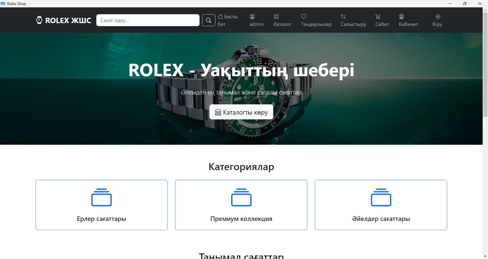

# Rolex — интернет-магазин часов

Веб-приложение интернет-магазина на **PHP + MySQL** с клиентской витриной и административной панелью. Интерфейс на русском и казахском языках, валюта — тенге (₸).



## Возможности

### Витрина
- Каталог товаров с категориями, поиском (AJAX) и пагинацией
- Карточка товара с галереей изображений и отзывами
- Корзина и оформление заказа
- Избранное (wishlist) и сравнение товаров
- Регистрация, вход и личный кабинет с историей заказов

### Админ-панель
- Дашборд и отчёты по продажам
- Управление товарами: добавление, редактирование, массовые операции, галерея изображений
- Управление категориями, заказами и пользователями
- Поиск и просмотр заказов, экспорт данных
- Журнал действий (activity log)
- Резервное копирование базы данных
- Настройки магазина (`app/Config/settings.json`)

## Технологии

- PHP 7.0+ (PDO, mbstring, GD, JSON)
- MySQL / MariaDB
- HTML, CSS, JavaScript
- Apache (XAMPP)

## Структура проекта

```
rolex/
├── admin/         # административная панель
├── app/
│   ├── Config/    # подключение к БД, helpers, settings.json
│   ├── Controllers/
│   ├── Models/    # Product, Category, Order, Customer, User, Review, ...
│   └── Views/     # общие шаблоны (header/footer)
├── assets/        # статические ресурсы
├── database/      # дамп базы данных (rolex_db)
├── public/        # клиентская часть магазина
├── uploads/       # загружаемые изображения товаров
├── install.php    # мастер установки базы данных
└── index.php      # точка входа (редирект на /public/)
```

## Установка (XAMPP)

1. Склонируйте репозиторий в каталог веб-сервера:
   ```bash
   cd C:\xampp\htdocs
   git clone <URL-репозитория> rolex
   ```
2. Запустите **Apache** и **MySQL** в XAMPP Control Panel.
3. Создайте базу данных `rolex_db` и импортируйте дамп из папки `database/` (через phpMyAdmin или консоль):
   ```bash
   mysql -u root -e "CREATE DATABASE rolex_db CHARACTER SET utf8mb4"
   mysql -u root rolex_db < "database/rolex_db (2).sql"
   ```
4. При необходимости измените параметры подключения в [app/Config/Database.php](app/Config/Database.php).
5. Откройте в браузере: <http://localhost/rolex/>

Вместо шагов 3–4 можно воспользоваться мастером установки: <http://localhost/rolex/install.php>.

> ⚠️ По умолчанию используется пользователь MySQL `root` без пароля — это подходит только для локальной разработки. В продакшене задайте отдельного пользователя и пароль.

## Автор

- [@aset4845](https://github.com/aset4845)
